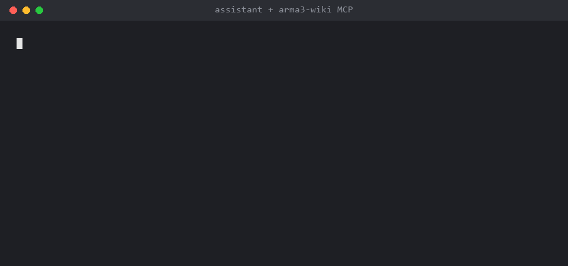

# arma3-wiki MCP server

[](https://github.com/ScottTMConnors/arma3-wiki-mcp/actions/workflows/ci.yml)
[](https://pypi.org/project/arma3-wiki-mcp/)

An MCP (stdio) server that gives AI assistants the Arma 3 scripting wiki: every
SQF command and event handler from
[acemod/arma3-wiki](https://github.com/acemod/arma3-wiki) (its `dist` branch),
plus bundled scripting tutorials.



The server keeps its own copy of the wiki data in a per-user cache folder. It
downloads it on first start, then refreshes in the background on every start and
every 24 hours while running. The `refresh_wiki` tool forces an update. If a
refresh fails, it keeps serving the cached data.

Tested on Windows, Linux and macOS with Python 3.10 and 3.14.

## Install

You need [uv](https://docs.astral.sh/uv/) or [pipx](https://pipx.pypa.io/). There
is nothing to clone and no venv to set up. MCP clients run one of these commands:

```bash
uvx arma3-wiki-mcp
```

```bash
pipx run arma3-wiki-mcp
```

Or install it once and run `arma3-wiki-mcp` directly:

```bash
pipx install arma3-wiki-mcp
```

Internet access is needed on first start to download the wiki data (about 11 MB).
If [git](https://git-scm.com/) is on your `PATH` the server keeps a shallow git
clone; otherwise it downloads a zip of the branch from GitHub.

## Register with an MCP client

### Claude Code

```bash
claude mcp add arma3-wiki -- uvx arma3-wiki-mcp
```

Or add it to a project's `.mcp.json`:

```json
{
  "mcpServers": {
    "arma3-wiki": {
      "command": "uvx",
      "args": ["arma3-wiki-mcp"]
    }
  }
}
```

### Claude Desktop

Add the same `mcpServers` block to `claude_desktop_config.json`
(Settings → Developer → Edit Config), then restart the app.

### Codex

In `~/.codex/config.toml`:

```toml
[mcp_servers.arma3-wiki]
command = "uvx"
args = ["arma3-wiki-mcp"]
```

### Other clients

Any client that supports stdio MCP servers works: run `uvx arma3-wiki-mcp`,
`pipx run arma3-wiki-mcp`, or `arma3-wiki-mcp` if you installed it with pipx.

## Tools

| Tool | Purpose |
|---|---|
| `lookup_command(name)` | Full YAML for an SQF command (syntax, locality, examples) |
| `lookup_event(name, category?)` | Full YAML for an event handler |
| `search(query, kind?, limit?)` | Keyword search over names, groups and text |
| `list_group(group)` | Commands in a wiki group; empty lists all groups |
| `list_tutorials()` / `get_tutorial(name)` | Bundled scripting tutorials |
| `wiki_status()` | Data revision, counts, last refresh |
| `refresh_wiki()` | Fetch upstream now |

## Environment variables

All optional.

| Variable | Default | Purpose |
|---|---|---|
| `ARMA3_WIKI_DATA` | Windows: `%LOCALAPPDATA%\arma3-wiki-mcp\wiki`<br>Linux: `~/.cache/arma3-wiki-mcp/wiki`<br>macOS: `~/Library/Caches/arma3-wiki-mcp/wiki` | Where the wiki data is stored |
| `ARMA3_WIKI_REFRESH_HOURS` | `24` | How often to refresh while running |
| `ARMA3_WIKI_UPSTREAM` | `https://github.com/acemod/arma3-wiki.git` | Data repository (must be on GitHub if git is not installed) |
| `ARMA3_WIKI_BRANCH` | `dist` | Data branch |

## Running from a source checkout

```bash
git clone https://github.com/ScottTMConnors/arma3-wiki-mcp.git
cd arma3-wiki-mcp
uv run arma3-wiki-mcp
```

Older setups that point an MCP client at `python /path/to/arma3-wiki-mcp/server.py`
keep working, and keep using the checkout's `wiki/` folder if it has one.

## Development

```bash
uv run pytest              # unit and end-to-end tests, no network
uv run pytest -m network   # also downloads the real wiki data
```

To regenerate the demo GIF: `uv run --with pillow docs/demo/render_demo.py`.
It runs the tool calls for real against the server and renders their results.

To release, bump `__version__` in `src/arma3_wiki_mcp/__init__.py` and push a
matching tag (`v0.1.0`); the Release workflow publishes it to PyPI.

## License

Server code: MIT (see [LICENSE](LICENSE)). The bundled tutorials and the
downloaded wiki data are Bohemia Interactive Community wiki content,
non-commercial use only; see [NOTICE.md](NOTICE.md).
